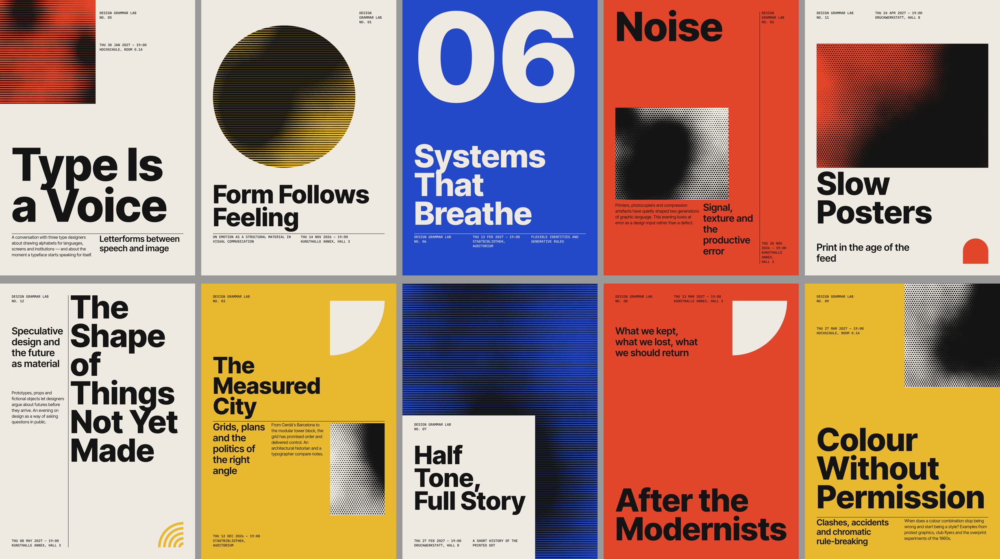

# Design Grammar Lab — Phase 1

A generative poster engine. A single **Style Grammar** (JSON) defines the visual language. A deterministic engine turns `seed + grammar` into a layout model, and p5.js draws it.



## Run

```bash
npm install
npm run dev        # http://localhost:5173  (add ?seed=anything for a specific batch)
npm run build      # type-check + production build
```

In the gallery:

- **Regenerate all** creates a new batch seed. The seed field and the `?seed=` URL make any batch reproducible.
- **Regenerate** on a card draws a fresh composition for that slot. It keeps the slot's strategy and content.
- **PNG** exports one poster at 1200×1696. **Export all PNG** downloads all ten.
- **Grid overlay** shows the modules and each text block's ink bounds. Bounds are blue when they pass and red when the validator flags them.

## Where the design rules live

| File | Controls |
|---|---|
| `src/grammar/style-grammar.json` | **All design tokens.** Canvas size, grid (6×8, margins, gutters, baseline), palette and colour modes, type roles (family, weight, size scale, leading), hierarchy ratios, motifs, rule thresholds, and content. |
| `src/engine/layouts.ts` | **The compositions.** Three strategies (typographic, image, editorial) with 3–4 variants each. Each variant is expressed only in grid modules. |
| `src/engine/composer.ts` | Placement rules. Grid snapping, mirroring, bleeds, gutter rules, and type hierarchy enforcement. |
| `src/engine/text.ts` | Overflow prevention. Picks the largest size on the role's scale that fits the box, and truncates with an ellipsis only as a flagged last resort. |
| `src/engine/validate.ts` | Checks after layout. Truncation, out-of-bounds text, text overlap, hierarchy ratios, and negative space. |
| `src/engine/grid.ts`, `random.ts`, `generate.ts` | Modular grid maths, the seeded RNG, and batch planning (strategies interleaved, variants rotated, content never repeated). |
| `src/render/p5Renderer.ts` | The p5 drawing of the layout model. This includes the procedural halftone and line-screen "images". |
| `src/ui/`, `src/App.tsx` | The React gallery only. |

`src/engine/` has no React or p5 imports. Text measurement is injected, so a future SVG renderer or a Node renderer can reuse the engine unchanged.

## Dependency notes (Oct 2026)

- **p5 2.3.x** (LGPL-2.1) runs in instance mode. Types are bundled with the package.
- **p5.js-svg** is not used. Its latest release (1.6.0, Apr 2025) supports only p5 1.11.x. Vector export is better added later as a second renderer of the layout model.
- Fonts come from **Inter Tight** and **IBM Plex Mono** via Fontsource (OFL). They are self-hosted, so there are no network calls.
